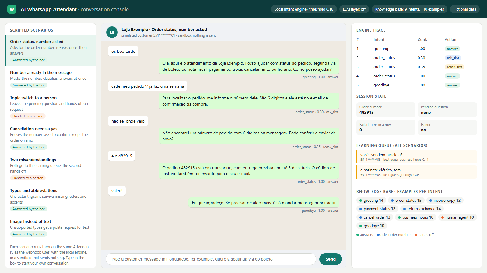
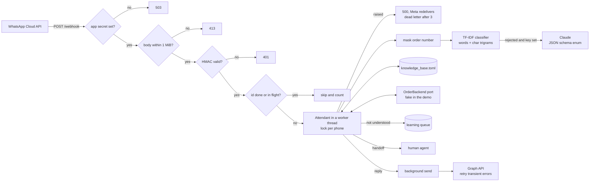
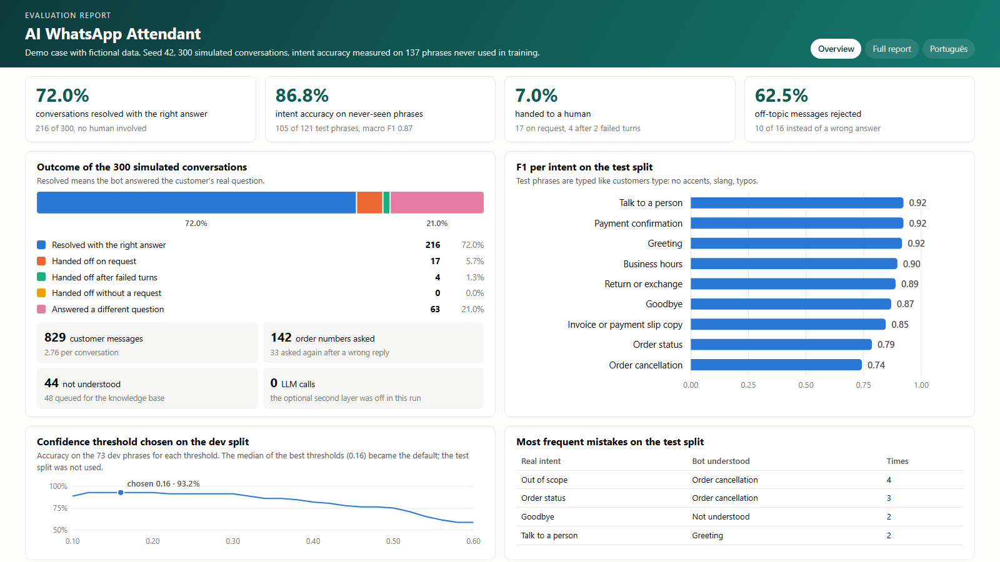

# AI WhatsApp Attendant

A WhatsApp Cloud API webhook that answers the common questions of an online store on its own, asks for the order number when it needs one, hands the conversation to a person when it should, and turns every misunderstood message into material for the next version of its knowledge base.

Demo case: fictional data, built as a portfolio project.

Python 3.13 · FastAPI · WhatsApp Cloud API · TF-IDF intent engine · optional Claude second layer · MIT license ([LICENSE](LICENSE))



## Problem

A store that sells online receives the same few questions on WhatsApp all day: where is my order, send me the payment slip again, did my payment go through, how do I return this, can I cancel, what time do you open. A person answering them by hand is slow at night and expensive by day. A bot that answers everything is worse: a confident wrong answer to "cancel my order" costs more than a polite "let me pass you to someone".

The hard parts are not the replies. They are knowing when the bot did not understand, collecting the order number without getting stuck, never answering twice when Meta redelivers an event, refusing forged calls, and measuring all of this honestly before a real customer sees it.

## What it does

- **Cloud API webhook.** `GET /webhook` answers Meta's verification, `POST /webhook` checks the `X-Hub-Signature-256` HMAC and answers text, button and list replies. It fails closed: without an app secret every event gets 503, and bodies over 1 MiB get 413 before any work. Messages are handled in a worker thread, so a slow classification never stalls `/health` or another customer, and a message id is marked done only after it was handled: a failure answers 500 so Meta redelivers it, and redelivered ids are skipped. Media messages get a polite request for text. Replies go out after the HTTP response, and only network errors and HTTP 408, 425, 429, 500, 502, 503 and 504 are retried, with exponential backoff.
- **Local intent engine.** TF-IDF over words and character trigrams, trained in milliseconds from an editable knowledge base (9 intents in Brazilian Portuguese). Trigrams survive the way people type on a phone: no accents, abbreviations, missing letters. Messages below a confidence threshold are rejected instead of guessed.
- **Dialogue rules.** One session per phone. Intents that need an order number ask for it, re-ask on a wrong reply and answer when it arrives; a number already in the message is used at once, and the order backend only answers about orders of the phone that asks. A confident new topic leaves the pending question, and a reply that brings a number for another order question takes it along. A cancellation is never done on a guess: the bot asks "Confirma o cancelamento do pedido 482915?" and waits for a yes, even when the number came from an earlier question. A negated request ("não quero mais cancelar", "não preciso de atendente") is never acted on. Two failed turns in a row, or a request for a person, hand the conversation to a human, and the bot goes silent.
- **Learning queue.** Every message the engine rejects is kept, with the phone and the order number masked and the engine's best guess, so the team can approve it as a new example.
- **Optional LLM second layer.** With `ANTHROPIC_API_KEY` set, only messages the local engine rejected go to Claude, with the order number masked, and the answer is constrained by a JSON schema whose intent is an enum of the known intents. Without the key nothing leaves the machine.
- **Operations.** Strict TOML configuration, secrets only from the environment, JSON logs to a rotating file with masked phones and hashed message ids (a `wamid` encodes the sender's phone), `/health` and a `health` command that exit non-zero on failure, `/metrics` with counters and p50/p95 latency.
- **Evidence.** One command runs a seeded evaluation and writes `evidencia/metricas.json`, an English and a Portuguese report and sample transcripts. A demo console and dashboard show the same engine running.

## How to run

Requirements: Python 3.13 and [uv](https://docs.astral.sh/uv/).

```bash
uv sync                                             # creates .venv with the dev tools
uv sync --extra llm                                 # same, plus the optional Claude layer
uv run pytest --cov                                 # 250+ tests, no network, coverage floor 90%
uv run python -m whatsapp_attendant evidence        # rebuilds evidencia/ (seed 42, 300 conversations)
uv run python -m whatsapp_attendant serve --demo    # http://127.0.0.1:8000/console and /dashboard
```

On Windows without uv on the path, the same commands run with `.venv\Scripts\python -m ...`. `python tasks.py check` runs lint, format check, tests with coverage and the evidence check in one go. The demo UI answers anyone who can reach it, so `serve --demo` refuses a host that is not a loopback address unless `--allow-remote-demo` is given; its console runs the local engine only, never the LLM layer, and `/docs` exists only in demo mode.

Try the webhook locally with a Cloud API payload:

```bash
export WA_VERIFY_TOKEN=change-me WA_APP_SECRET=dev-secret
uv run python -m whatsapp_attendant serve
curl "http://127.0.0.1:8000/webhook?hub.mode=subscribe&hub.verify_token=change-me&hub.challenge=42"
body='{"entry":[{"changes":[{"value":{"messages":[{"from":"5511000000001","id":"wamid.1","type":"text","text":{"body":"cadê meu pedido 482915?"}}]}}]}]}'
sig=$(printf '%s' "$body" | openssl dgst -sha256 -hmac "$WA_APP_SECRET" | sed 's/^.* //')
curl -X POST http://127.0.0.1:8000/webhook -H "content-type: application/json" -H "x-hub-signature-256: sha256=$sig" -d "$body"
curl http://127.0.0.1:8000/metrics
uv run python -m whatsapp_attendant health --url http://127.0.0.1:8000   # exit 0 or 1
```

### Configuration and secrets

Tunables live in a TOML file; [config.example.toml](config.example.toml) documents every key and is tested to equal the built-in defaults. Pass it with `--config` or `ATTENDANT_CONFIG`. Unknown keys and out-of-range values stop the service with a message that names the key (`python -m whatsapp_attendant check-config FILE`). The knowledge base is [knowledge_base.toml](src/whatsapp_attendant/data/knowledge_base.toml), validated the same way.

| Variable | Used for | Without it |
|---|---|---|
| `WA_VERIFY_TOKEN` | webhook verification | verification always answers 403 |
| `WA_APP_SECRET` | HMAC check of every event | the webhook answers 503 and `/health` fails; `whatsapp.allow_unsigned = true` accepts unsigned events, for local tests only |
| `WA_ACCESS_TOKEN`, `WA_PHONE_NUMBER_ID` | sending through the Graph API | replies are recorded in memory, nothing is sent; the token without `WA_APP_SECRET` stops the service at startup |
| `ANTHROPIC_API_KEY` | optional LLM second layer (install it with `uv sync --extra llm`) | local engine only, no outbound call |

## Architecture



The design keeps the expensive and unpredictable parts at the edge. The local engine decides most messages in well under a millisecond and can be tested offline; the LLM is a fallback for what the engine rejects, never a dependency. Every external system sits behind a small interface (`IntentProvider`, `Sender`, `OrderBackend`), so a real ERP, Twilio or another LLM provider is one class, not a rewrite. Decisions are recorded in [docs/adr](docs/adr): [stack](docs/adr/ADR-001-stack.md), [local engine first](docs/adr/ADR-002-local-intent-engine.md), [in-memory state](docs/adr/ADR-003-in-memory-state.md), [evaluation protocol](docs/adr/ADR-004-evaluation-protocol.md), [leakage on the model's representation](docs/adr/ADR-005-leakage-on-the-model-representation.md) and [webhook processing](docs/adr/ADR-006-webhook-processing.md).

| Path | What is there |
|---|---|
| [src/whatsapp_attendant](src/whatsapp_attendant) | `api` (webhook, health, metrics), `whatsapp` (payloads, signature, sender), `dialogue` (rules), `nlu` (classifier), `providers` (local and LLM), `knowledge`, `config`, `store`, `logs`, `metrics` |
| [src/whatsapp_attendant/data](src/whatsapp_attendant/data) | knowledge base, dev split and frozen test split |
| `evaluation.py`, `simulation.py`, `evidence.py`, `report.py` | evaluation, seeded simulation and reports |
| [evidencia](evidencia) | `metricas.json`, reports in English and Portuguese, transcripts, benchmark |
| [docs](docs) | [spec](docs/specs/SPEC-001-whatsapp-ai-attendant.md), ADRs, [runbooks](docs/runbooks/README.md), [operations](docs/operations.md) (SLOs, RACI, risks, roadmap) |
| [vitrine](vitrine) | portfolio cards, covers and screens, with the generator in `vitrine/src` |
| [CHANGELOG.md](CHANGELOG.md) | release notes (Keep a Changelog, SemVer) |

## Results

All numbers come from `evidencia/metricas.json`, produced by `python -m whatsapp_attendant evidence` with seed 42. A test regenerates it and fails if it differs from the committed file.

| Measure | Value | How it was measured |
|---|---|---|
| Conversations resolved with the right answer | **80.7%** (242 of 300) | 300 simulated conversations; resolved only when the bot answered the customer's real main question, with no handoff and no wrong answer on the way |
| Same, without the 25 customers who asked for a person | 88.0% (242 of 275) | excludes conversations whose main question was "talk to a person" |
| Handed to a person | 7.3% (22) | 21 on request, 1 after two failed turns in a row |
| Wrong answer or wrong flow | 12.0% (36) | 34 got a wrong answer; 2 were only asked for something they did not need (an order number or a cancellation); all counted as failures |
| Wrong cancellations stopped | 38 | the bot asked to confirm a cancellation for another question, and the customer said no |
| Resolved if customers never rephrase | 69.7% | same seed and customers, but nobody tries again after a rejection or a wrong confirmation |
| Intent accuracy on held-out phrases | **85.3%** (93 of 109) | frozen test split; no phrase is the same model input as a training or dev phrase |
| Macro F1 on the test split | 0.85 | per intent from 0.69 (cancellation) to 0.92 |
| Off-topic messages rejected | 62.5% (10 of 16) | the rest got a wrong intent; four were taken as a cancellation |
| Confidence threshold | 0.16 | chosen on the dev split (93.0% accuracy there); the test split was not used |

How the numbers were protected: the classifier learns only from the 110 knowledge base examples; a dev split of 71 phrases chose the threshold and guided edits of the examples; the test split of 125 phrases (109 in scope, 16 off topic) was committed before the evaluation code and has only lost phrases since. Leakage is measured in the representation the model uses ([ADR-005](docs/adr/ADR-005-leakage-on-the-model-representation.md)): two phrases with the same words once stopwords are dropped, in any order, or with a TF-IDF cosine of 0.95 or more, are the same input, and a test fails if any phrase of one set is the same input as one of another. That rule removed 12 test phrases and 2 dev phrases that an earlier, text-only rule had let through. Simulated customers draw their messages from the test split and add typos, filler words and order numbers at random; they rephrase once after a miss, say yes to a correct cancellation question and no to a wrong one. The drop from 95.1% in-scope accuracy on dev to 85.3% on test is the expected cost of choosing on one set and reporting on another. These numbers replace those of version 1.0.0; the [changelog](CHANGELOG.md) says what changed and why.

Latency on the development machine was 0.14 ms at p50 and 0.20 ms at p95 per message for the local engine ([benchmark.json](evidencia/benchmark.json), machine dependent and kept out of `metricas.json`). Full report: [evidencia/report.html](evidencia/report.html), in Portuguese [evidencia/relatorio.html](evidencia/relatorio.html).



## Limitations

- **Simulated, not real traffic.** One author wrote the examples and both evaluation splits. 109 test phrases give an uncertainty of roughly 7 points on the accuracy. The simulated customer is patient: without the one rephrase after a miss, 69.7% of the conversations are resolved instead of 80.7%. Real messages from the store are the first thing to collect.
- **About one conversation in nine gets a wrong answer** (34 of 300). The threshold that maximized dev accuracy is low, so the engine prefers answering to rejecting. The LLM layer only sees rejected messages, so it does not fix these. The cancellation question already stops the costliest mistake; the same yes or no question for other low-confidence answers is the next step, measured against this baseline.
- **Negation is a rule, not understanding.** A negation word negates the first content word of its clause, so "não quero mais cancelar" and "não preciso de atendente" are caught, but a long-range or ironic negation ("eu nunca disse que queria cancelar") is not.
- **Off-topic rejection is weak (62.5%).** "Cancel my phone plan" looks like an order cancellation. More off-topic examples or a margin rule between the top two intents would help; neither is in this version.
- **The LLM layer is not evaluated.** It is tested with a fake client only, because a real run needs a key and costs money.
- **State lives in memory.** Sessions, idempotency ids and the learning queue are lost on restart and are not shared between replicas (ADR-003). Production needs Redis or a database behind the same interfaces.
- **No real store behind it.** The order lookup is a deterministic fake; payment slips and invoices are not really sent.
- **Brazilian Portuguese only, text only.** Another language needs its own examples and evaluation; audio and images are answered with a request for text.
- **Graph API version.** The default `v23.0` must be checked against Meta's current version before going live.

## Resumo em português

Case demonstrativo com dados fictícios. Webhook da WhatsApp Cloud API para uma loja virtual fictícia: entende a dúvida do cliente com um motor de intenções local (TF-IDF com trigramas de caracteres, robusto a erro de digitação), pede o número do pedido quando precisa, confirma com sim ou não antes de cancelar, não age quando o cliente nega ("não quero mais cancelar"), transfere para um atendente depois de duas falhas seguidas ou a pedido do cliente e guarda as mensagens não entendidas numa fila de aprendizado. Tem verificação de assinatura HMAC que recusa tudo sem o segredo, limite de tamanho do corpo, idempotência contra reenvio da Meta com marcação só depois do sucesso, reenvio só em erro temporário, logs JSON com telefone mascarado e id de mensagem com hash, health check e métricas. Um modelo de linguagem opcional entra só nas mensagens que o motor local recusou.

Em 300 conversas simuladas com semente fixa, 80,7% foram resolvidas pelo robô com a resposta certa e 7,3% foram para um atendente. O acerto de intenção foi de 85,3% em 109 frases de teste que não repetem, para o modelo, nenhuma frase de treino ou de desenvolvimento. Os números, os limites e a forma de medir estão nas seções acima e no relatório em português ([evidencia/relatorio.html](evidencia/relatorio.html)).
